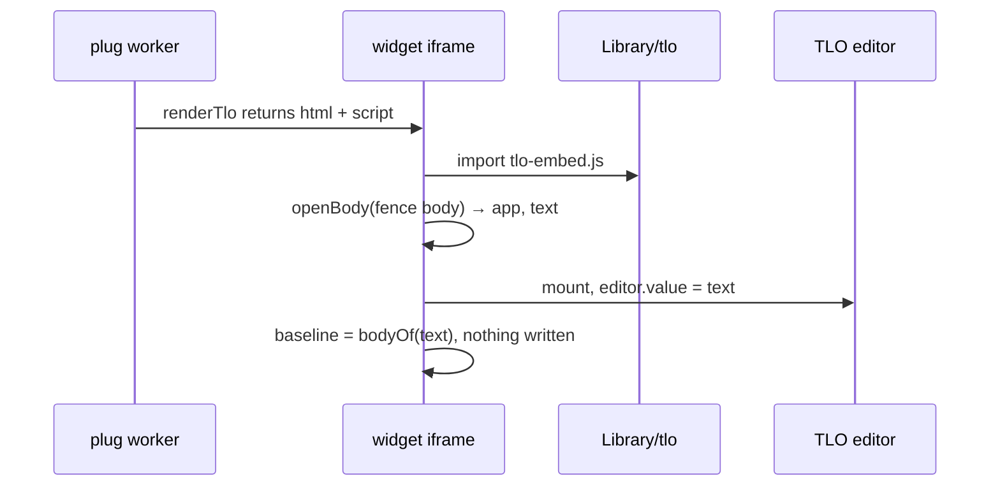
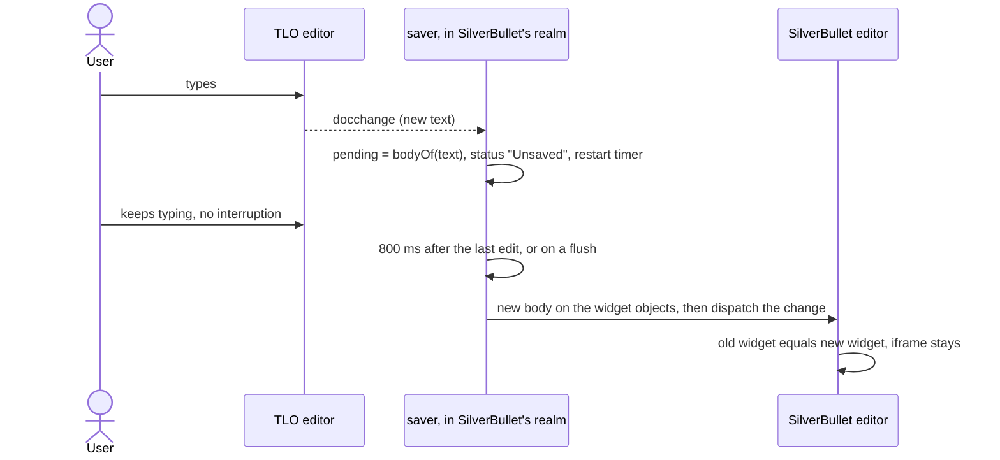

# How the TLO plug works

A ` ```tlo ` fence renders as a live Tiny Little Office editor, and edits flow back into the Markdown. Everything runs in the browser, from files in the space. There is no extra server.

## One frame

```text
SilverBullet page                 same origin
└─ widget iframe                  finds the fence, writes the text
   └─ <to-sheet-editor>           TLO's real editor, loaded from .fs/Library/tlo/
```

TLO's own site keeps the document in the address bar. That belongs to its shell, not its editors. Every editor is an element with one contract:

```text
editor.value = text                        # the document in
editor fires "docchange" with new text     # every edit out
```

So the plug builds the editors from upstream's source and skips the shell.

| Constraint found | Consequence |
| --- | --- |
| TLO's shell unregisters every service worker on its origin | Leave the shell out of the build |
| The shell registers each app's commands, and the published bundle hides that function | Build from source instead of loading the bundle |
| Editors expect `<to-chrome>` around them for layout and the toolbar | Keep it, hide its header with CSS |
| A widget iframe's base URL is the page's folder | Resolve the library against the parent's `baseURI` |
| SilverBullet rebuilds a widget when its fence body changes | Set the new body on the live widget objects just before writing |
| A removed iframe's timers stop | The saver runs in SilverBullet's realm |
| A document change during SilverBullet's immediate save cancels it and hangs the navigation behind it | Flush before that save starts, not on popstate |
| Moving an iframe in the DOM reloads it | Enlarge it in place, in the top layer |

## What replaces the shell

`lib/embed.ts`, about 100 lines:

```text
mount(host, { app, text, onChange })
  appOf(app).editor()            # defines to-<app>-editor
  appOf(app).commands()          # register: toolbar and keys
  initLanguage()
  <to-chrome .main=editor>       # layout, toolbar, scrolling
  keydown → runKey(UNDO, REDO)   # forwarded as docundo / docredo
  click on a link → new tab      # the widget's base target is _top
```

## Opening a document



## Saving an edit



The saver's write, as a call tree. It is synchronous, so saves cannot overlap and the last text always wins:

```text
timer, blur, Ctrl/Cmd+S, Save button, tab hidden, SilverBullet's immediate save
  flush
    client.currentName                # refuse if another page is open
    client.isReadOnlyMode             # refuse: SilverBullet would never store it
    locateFence(text, body, widgetPosition)
      position known                  → the match holding it, or refuse
      no position, one match          → use it
      no position, identical fences   → refuse
      no match                        → "Not saved", page untouched
    renderFence(pending)              # longer fence if the document nests ```sheet
    changeBetween(old fence, new fence)   # only the changed part: the fence's first line stays
    liveWidgets                       # iframe.cmTile.widget, and the widget in the current decorations
    widget.bodyText = new body        # both, just before the change
    view.dispatch                     # same tick
```

Why both widget objects. The object holding the iframe decides: with only the decorations' object changed, the iframe is rebuilt (checked by removing each in turn). It can be older than the one in the decorations, because an equal widget leaves the old object in place. With only the held object changed the iframe also stays, but CodeMirror treats the position as changed and takes the iframe through its reuse cache. Changing both means it never looks at that line. If neither is found, the write still happens and the widget rebuilds.

| When | What happens to waiting edits |
| --- | --- |
| Iframe unmounted: scrolled away, cursor enters the fence | `pagehide` → written right after CodeMirror's update, which forbids dispatching during it |
| Navigating away | Written before SilverBullet's immediate save, so they go with the page |
| Fence changed from outside | The body no longer matches, or matches only a twin outside the widget's position: nothing is written, a notification names the page, and the text goes to the console |
| Typed during a page change, too late for the page's last save | Still waiting: refused as above. Already in the buffer: the disk is read after the page changes, and a missing fence gets the same report |
| Tab closing | `beforeunload` flushes and asks, since SilverBullet's own save runs a second later and its warning saw nothing yet |
| "Widgets: Refresh All" | Evaluates the script again in the same window, with an old body. The new run takes the body from the previous one |

A blur always flushes. The old guard against a blur with the whole window unfocused protected a file picker from a rebuild. There is no rebuild now, and the timer would fire during a picker anyway.

## Fullscreen

```text
Fullscreen button
  line keeps its height                # --tlo-held-height, min-height on the .cm-line
  iframe.popover = "manual"; showPopover()   # top layer: no DOM move, no reload, above every z-index
  iframe's document keeps its height, #tlo-root floats over it
                                       # so setHeight and the height cache only ever see the normal size
  scroll capture on the page           # CodeMirror measures inside its own scroll listener, so stop it first
Minimize button, or Escape
  undo all of it; #tlo-root's own height was never touched, so a dragged size survives
```

Only one document can be enlarged, because the page holds one line height: enlarging another minimizes the first.

Styles for the page live in `src/host.css`, added once as `#tlo-host-style`. The widget marks its iframe with `data-tlo`, which also scopes hiding SilverBullet's copy button: the rule matches a line holding such an iframe. A fence's language appears nowhere else in that DOM.

## Pasted links

```text
editor:pageModified
  inserted text contains "#/v1/" or "doc="?  → no: stop    # runs per keystroke, so stay cheap
  tlo.embedPastedLinks on?
    linkReplacements(page text)   # lines holding only a TLO link, outside fences
    editor.replaceRange           # link becomes a ```tlo fence holding the link
```

A link fence keeps storing a link: the widget swaps only the fragment. **Convert to text** switches it to `.tlo` text.

## Install layout

SilverBullet installs a library by fetching each entry of the page's `files:` list, so `build.sh` generates that list.

| Constraint found | Consequence |
| --- | --- |
| The `github:` and `ghr:` readers keep only one path segment | `dist/lib` is flat, and `build-lib.sh` fails if it is not |
| `ghr:` makes one GitHub API call per file, with a limit of 60 an hour | Installs read the `dist` branch through `github:`, which uses raw files |
| A `https://github.com/` URI is rewritten to raw file paths, which breaks release download links | Same |
| An update runs only when the page's hash changes | The page carries `version` and `build`, a hash of the plug and editors |
| An update never removes files | Hashed chunks from older versions stay in `Library/tlo/`. They are unused, and removing the library leaves them too |

`test/e2e.mjs` installs `dist/plug` through SilverBullet's installer before every run, from a local server with raw.githubusercontent.com's content types. Every other scenario then runs against that install.

## Limits

* The cold-start blank widget: when a page with a fence in a list is the first page in a fresh browser and a selection change lands during startup, the iframe stays `about:blank`. The cause is unproven. The browser tests pass because earlier scenarios warm the browser; run alone, the `Listed` scenario still fails.
* A widget that does get rebuilt starts a new TLO undo history: when it scrolls far out of view, when the cursor enters the fence, or when the fence changes from outside. SilverBullet's own undo reverts saves, one per save.
* Each widget evaluates the 2 MB editor bundle in its own iframe. The browser caches the download.
* The first save rewrites the fence in TLO's canonical form, which can move `app:` within the head.
* A fence changed from outside, by editing its source or by a sync, wins. Edits from the last 800 ms that had not been written stay out of the page: a notification says so and the text goes to the browser console.
* An edit typed while a page change runs can miss the page's last save. It gets the same notification and console copy.
* An iframe unmounted right after text was added above its fence refuses the waiting edit in the same way, because its position is out of date and writing could hit an identical fence.
* Fences inside blockquotes are not found. An indented code sample with an unpaired fence opener can also hide later fences. In both cases the widget reports "Not saved" and leaves the page alone.
* With the cursor inside a fence, SilverBullet shows the raw source, with its copy button.
* The Trip Planner's map loads tiles from OpenFreeMap. It is the only feature that contacts another server. **Open ↗** opens a copy on tinylittleoffice.com, and the document stays in the link's fragment.
* Password-locked links cannot be opened in a fence.
* TLO's title box, Share, Download, Find and menu belong to the shell and are not in the widget.

## Files

```text
src/
├── fence.js          # pure text logic, shared by worker and widget, unit tested
├── plug.js           # worker: manifest, commands, renderTlo, small syscall runtime
├── saver.js          # debounce and write, in SilverBullet's realm, unit tested
├── widget.js         # widget iframe: status, mount, flush events, fullscreen
├── widget.css
└── host.css          # added to SilverBullet's page: copy button, enlarged iframe
lib/
├── embed.ts          # TLO's editors without the shell
└── vite.config.ts    # upstream's chunking, one app file
Library/tlo.md        # the library page; build.sh fills in version and files
test/
├── fence.test.js     # text logic
├── saver.test.js     # saving against a stand-in client
├── e2e.mjs           # Node's WebSocket driving headless Chrome
└── fetch-tools.sh    # the pinned SilverBullet and Chrome
UPSTREAM              # the pinned TLO commit
build-lib.sh          # upstream source → dist/lib
build.sh              # src/ and dist/lib → dist/plug, optionally into a space
scripts/publish.sh    # the release workflow's dist branch and GitHub release
```
